# za-donut-auto

Switch 2 版『Pokémon LEGENDS Z-A』（DLC）のドーナツ厳選を自動化するツール。

<p align="center">
  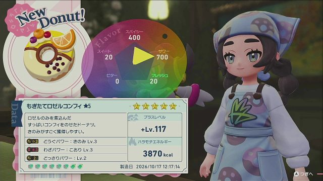
</p>

- ドーナツを作ってパワーを読み取り、外れならバックアップから読み込み直して作り直す
- 狙いのパワーがそろったら、ポケモンセンターで回復してバックアップを取り、Discord に報告する
- 使うきのみ（レシピ）と狙うパワーは、厳選の途中でも Discord から変えられる

操作はすべて Python + OpenCV（+ Windows 標準の OCR）で動く。AI は使っていない。1 回の試行は約 56 秒。

## もくじ

- [しくみ](#しくみ)
- [1 回の試行の流れ](#1-回の試行の流れ)
- [画面の読み取り方](#画面の読み取り方)
- [必要なもの・セットアップ](#必要なものセットアップ)
- [使い方](#使い方)
- [レシピと狙いの設定](#レシピと狙いの設定)
- [止まる・聞かれるとき](#止まる聞かれるとき)
- [注意](#注意)
- [構成](#構成)

## しくみ

```
Switch 2 ──HDMI──▶ キャプチャボード ──▶ OBS（仮想カメラ）──▶ PC（Python）
   ▲                                                          │ 画面を判定して次の操作を決める
   └──── Bluetooth（プロコンとして接続）──── Pico W ◀──USB シリアル─┤
                                                               │
                                                     Discord（通知・ボタン・コマンド）
```

| 役割 | 担当 |
|---|---|
| ボタン入力（手） | Raspberry Pi Pico W。[PicoSwitchController](https://github.com/Wilstride/PicoSwitchController) で Pro コントローラーになりすまし、PC からのコマンドでボタンとスティックを動かす |
| 画面の取り込み（目） | キャプチャボード → OBS の仮想カメラ → OpenCV |
| 判定・制御（頭） | 画面の目印はテンプレートマッチング、パワー名ときのみ名は Windows の日本語 OCR |
| 報告・遠隔操作 | Discord Bot（当たりの報告、ボタンでの返事、スラッシュコマンド） |

## 1 回の試行の流れ

各段階で「想定した画面になったか」を確かめながら進む。想定外の画面になったら、ソフトを終了して最初からやり直す。

| | | |
|:-:|:-:|:-:|
| 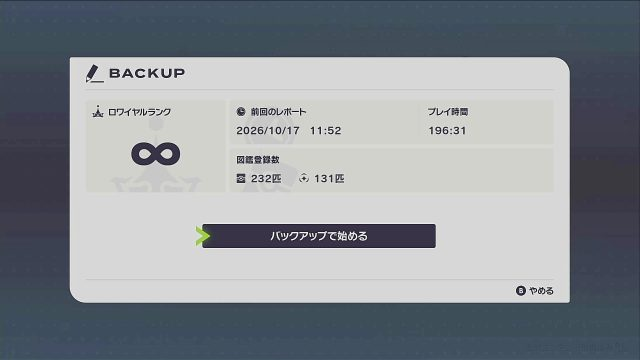<br>**① バックアップで始める**<br>ソフトを終了 → 起動 → タイトルで X＋B＋↑ | 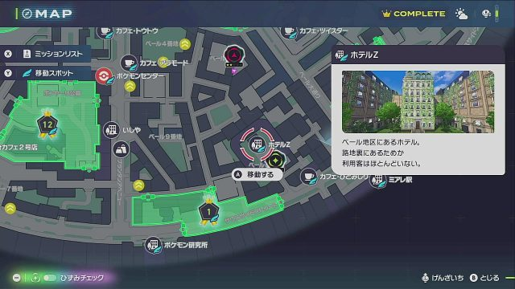<br>**② ホテルZ へ**<br>マップでホテルZ を選んでファストトラベル | 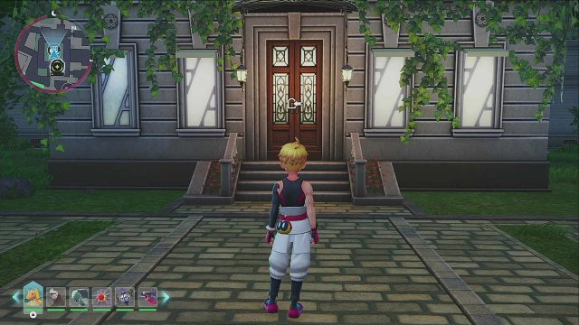<br>**③ ドアへ**<br>「A はいる」が見えた瞬間に止まる |
| 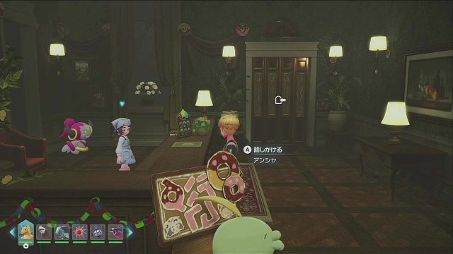<br>**④ アンシャへ**<br>「アンシャ」の名前が見えたら話しかける | 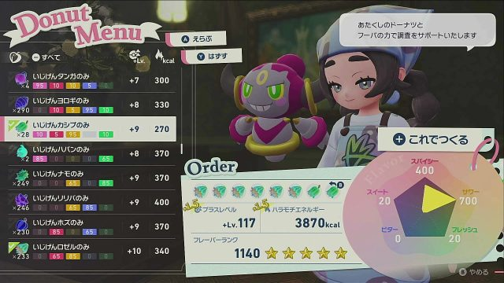<br>**⑤ きのみを選ぶ**<br>レシピのきのみを、名前と残り個数で確かめて選ぶ | 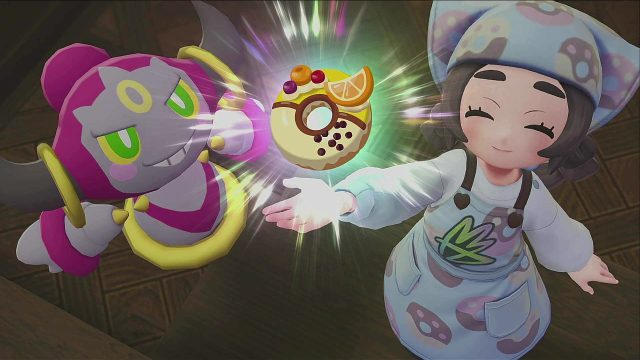<br>**⑥ 作る**<br>調理の演出は A で飛ばす |
| <br>**⑦ パワーを読む**<br>外れなら ① へ。当たりなら ⑧ へ | 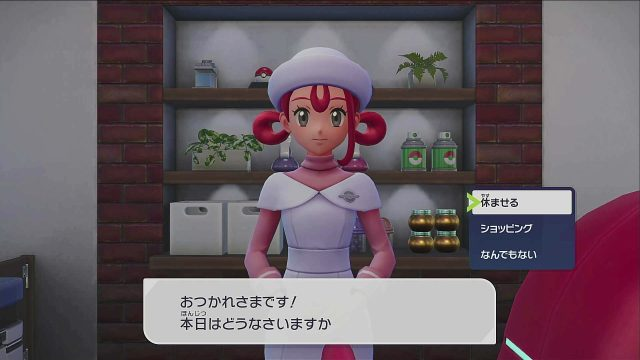<br>**⑧ ポケモンセンターで回復**<br>「休ませる」でバックアップが取られる | 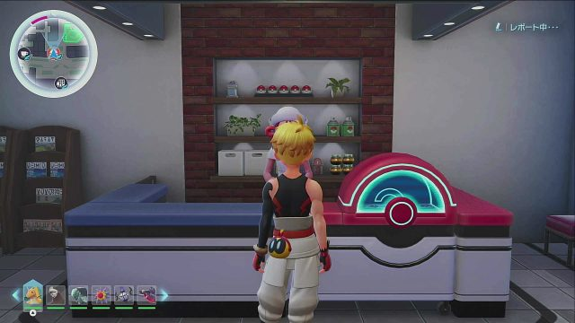<br>**⑨ 保存を待つ**<br>右上の「レポート中」が消えたら完了 |

当たりのバックアップが終わると、Discord できのみの残り個数（あと何個作れるか）を伝え、「続ける / きのみがなくなるまで続ける / 止める」を聞く。

ゲーム側の手順の詳細は [making-donut.md](making-donut.md)、開発の経緯は [ROADMAP.md](ROADMAP.md)。

## 画面の読み取り方

### 画面の目印（テンプレートマッチング）

実機のスクショから切り出した小さな画像（`templates/`）を画面と照合して、今どの画面にいるかを判定する。

| 目印 | 使いどころ |
|---|---|
|  | ホテルZ のドアの前に着いた |
|  | アンシャに話しかけられる位置に着いた（「ゴクリン」などと区別するため名前で見る） |
|  | 結果画面のパワー欄が表示し終わった |
|  | セーブ中（消えるまで待つ） |

### パワー名（OCR）

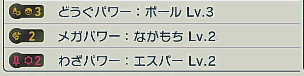

結果画面のパワー欄 3 行を OCR で読み、既知のパワー名の一覧（`za_donut/powers.py`）に当てはめる。OCR は濁点を落としたり似た文字を取り違えたりするので、それを吸収して照合する。

| 画面の表記 | OCR の結果 | 当てはめ |
|---|---|---|
| どうぐパワー：ボール Lv.3 | とうぐ八ワー：ボールLv.3 | どうぐパワー：ボール Lv.3 |
| メガパワー：ながもち Lv.2 | メカパワー：ながもちLv.2 | メガパワー：ながもち Lv.2 |
| わざパワー：エスパー Lv.2 | わさパワー：工スパーLv.2 | わざパワー：エスパー Lv.2 |

一覧にないパワーは近い名前と取り違えず「知らないパワー」として扱い、OCR の結果をログに残す。

### きのみの名前と残り個数

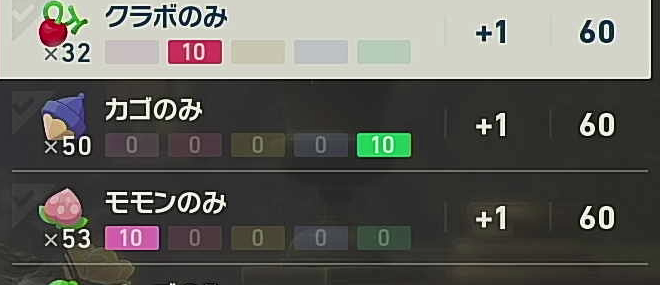

カーソルが乗っている行（明るい行）の名前を OCR で読み、残り個数は数字の見本と照合して読む（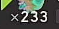）。

一覧には持っているきのみだけが並ぶので、並び順は持っている数で変わる。最初に一度、一覧を端から端まで読んで並びを覚え（`state/berry_list.json`、30 秒ほど）、2 回目からは覚えた並びの何番目かで近いほう（上から・下から）へカーソルを動かす。着いた先で名前を確かめ、選ぶ前と後で残り個数が使う数だけ減ったかを確かめる。

## 必要なもの・セットアップ

- Switch 2 と『Pokémon LEGENDS Z-A』（DLC）
- Raspberry Pi Pico W（ファームウェアの書き込み手順は [docs/firmware-build.md](docs/firmware-build.md)）
- HDMI キャプチャボード（1920×1080）と OBS Studio
- Windows PC（日本語の OCR を使うため日本語の言語パックが必要）と Python 3.11
- Discord（任意。無くてもアラーム音で知らせる）

```
pip install -r requirements.txt
```

1. Pico W を PC に USB で挿し、Switch の「コントローラー」→「持ちかた/順番を変える」でプロコンとして接続する。
2. OBS でキャプチャボードの映像を出し、「仮想カメラ開始」を押す。
3. Discord で通知を受けるなら、[docs/discord-setup.md](docs/discord-setup.md) の手順で `config/discord.json` を作り、`python tools/discord_test.py` で確認する。
4. ポケモンセンター：ベールでバックアップを取っておく（試行のたびにここから読み込み直す）。

## 使い方

Switch を HOME 画面（ZA にカーソル）またはゲーム中にしておき、次を実行する。止めるときは Ctrl+C。

```
python tools/run.py --device "OBS Virtual Camera"
```

| オプション | 内容 |
|---|---|
| `--max N` | N 回試行したら終わる（既定は無制限） |
| `--until-out` | 最初から「きのみがなくなるまで続ける」で動かす |
| `--no-discord` | `config/discord.json` があっても Discord を使わない |
| `--no-alarm` | Discord を使わないとき、当たりや停止でアラームを鳴らさない |
| `--debug` | ログファイルを `logs/` に、画面を `screenshots/` に残す（通常は何も残さない） |

## レシピと狙いの設定

### レシピ（使うきのみ）: `config/recipe.json`

プリセット名か、使うきのみと個数（合わせて 8 個まで。名前は「のみ」を除いたもの）を書く。選ぶ順番は自動で決める。

```json
{"preset": "サワー系"}
```

```json
{"berries": {"いじげんロゼル": 6, "いじげんカシブ": 2}}
```

| プリセット | きのみ | 主なパワー |
|---|---|---|
| サワー系 | いじげんカシブ ×2 ＋ いじげんロゼル ×6 | どうぐ・どっさり・メガ |
| スイート系 | いじげんタンガ ×2 ＋ いじげんハバン ×6 | かがやきなど |

### 狙うパワー: `config/target.json`

「この組み合わせがそろえば当たり」を、パワー名と最低レベルで書く。複数書けば、どれか 1 つがそろえば当たり。

```json
{
  "targets": [
    {"powers": {"かがやきパワー：みず": 3}, "count": 1},
    {"powers": {"かがやきパワー：ほのお": 3}, "count": 1}
  ],
  "always": [{"かがやきパワー：ぜんぶ": 3}]
}
```

- `count`：その組み合わせで当たりをこの数だけバックアップしたら、狙いから外す（書かなければ上限なし）。狙いが 1 つも残らなくなったら止まる
- `always`：いつも当たりにする組み合わせ。Discord から狙いを置き換えても消えない
- `{"どうぐパワー：きのみ": 2, "どっさりパワー": 3}` のように、パワー名とレベルだけ書いてもよい（上限なし）

主なパワーは次のとおり。1 つのドーナツには、カテゴリごとに 1 つまで付く（この性質も判定に使う）。

| 味 | カテゴリ | パワー |
|---|---|---|
| サワー | どうぐ | どうぐパワー：きのみ / ボール / おたから / アメ / コイン / とくべつ |
| サワー | 異次元 | どっさりパワー / メガパワー：チャージ / メガパワー：ながもち |
| スイート | かがやき | かがやきパワー：〇〇（18 タイプ）/ かがやきパワー：ぜんぶ |
| スイート | 大きさ | オヤブンパワー / でかでかパワー / ちびちびパワー |
| フレッシュ | ほかく | ほかくパワー：〇〇（18 タイプ） |

### 厳選の途中で変える（Discord）

報告先のチャンネルでスラッシュコマンドを使う。次の試行から使われ、`config/recipe.json` / `config/target.json` にも保存される。使えるのは `config/discord.json` に登録した本人だけ。

| コマンド | 内容 |
|---|---|
| `/recipe_show` | 今のレシピを表示 |
| `/recipe_preset` | プリセットから選ぶ |
| `/recipe_set` | きのみと個数を自由に決める（4 種類まで） |
| `/target_show` | 今の狙いを表示 |
| `/target_set` | 狙いをこの組み合わせ（パワーとレベルを 3 つまで、`count` で個数の上限）に置き換える（`always` は残る） |
| `/target_add` | 別の組み合わせを「または」で追加する（`count` で個数の上限） |

## 止まる・聞かれるとき

| 状況 | 動き |
|---|---|
| 当たり | Discord に通知してバックアップし、きのみの残り個数を添えて「続ける / きのみがなくなるまで続ける / 止める」を聞く |
| 読めないパワーがあり判定できない | 結果画面のまま、Discord で「バックアップする / 捨てて続ける / 止める」を聞く（外れをバックアップすると、そのドーナツの分のきのみが減るため） |
| レシピのきのみが足りない | Discord に通知して停止 |
| 昼夜の切り替わりの演出が入った | 演出が終わるのを待ってホテルZ からやり直す。Discord で「バックアップを取り直すか」を聞く（10 分返事がなければ取り直さない） |
| 想定外の画面で止まった | ソフトを終了して最初からやり直す。3 回続いたら停止して Discord に通知 |
| バックアップの途中で失敗 | 状態が分からないので自動ではやり直さず、停止して Discord に通知 |

## 注意

- **ポケモンセンターで回復するとバックアップが上書きされる。** ドーナツは作った時点でオートセーブされるので、外れをバックアップしても当たりが消えることはないが、そのドーナツの分のきのみは減る。
- **Pico を抜き挿しすると再ペアリングが必要。** ファームウェアが起動のたびに Bluetooth アドレスを変えるため。接続が切れて入力が届かなくなったときも「持ちかた/順番を変える」で再接続する。
- **OBS を閉じない。** キャプチャボードは OBS が掴んでいるので、仮想カメラ経由で取り込んでいる。
- ファームウェアの癖として、`PRESS` コマンドは Switch に届かず、スティックの初期値は端（倒しっぱなし）になっている。`za_donut/pico.py` が HOLD → RELEASE で押し、接続時にスティックを中央へ戻して対処している。

## 構成

```
za_donut/
  pico.py       Pico W へのシリアルコマンド（ボタン、スティック）
  screen.py     キャプチャ（最新フレームだけを保持する読み取りスレッド付き）
  vision.py     テンプレートの定義と画面判定、きのみの残り個数の読み取り
  powers.py     パワー名の一覧と、結果画面のパワー欄の読み取り（OCR）
  target.py     狙うパワーの設定と当たりの判定、Discord のコマンド
  berries.py    きのみの一覧とレシピの設定、きのみ選択画面の読み取り、Discord のコマンド
  runner.py     手順の各段階（起動、移動、きのみ選択、作成、バックアップ）
  notify.py     Discord への通知とボタンの受け取り
  paths.py      設定ファイル・記録ファイルの置き場所
  steps.py      調整用の値と、1 ステップずつ試すための操作
tools/
  run.py                自動厳選の本体
  run_step.py           1 ステップずつ実行してスクショを撮る（調整用）
  make_templates.py     スクショからテンプレートを切り出す（座標は vision.py の SPECS）
  make_count_digits.py  きのみの残り個数を読むための数字の見本を作る
  capture.py            キャプチャのプレビューとスクショ保存
  pico_console.py       Pico に手でコマンドを送るコンソール
  discord_test.py       Discord の接続テスト
config/         設定（recipe.json・target.json・discord.json）。discord.json は git 管理外
state/          プログラムが書く記録（きのみ一覧の並び、前回の残り個数）。git 管理外
templates/      画面判定用のテンプレート画像
docs/           ファームウェアのビルド手順、Discord の設定手順、README の画像
```

テンプレートを足したら `python tools/make_templates.py` で `templates/` を作り直す（切り出し元のスクショは `screenshots/steps/` にあり、git 管理外）。
